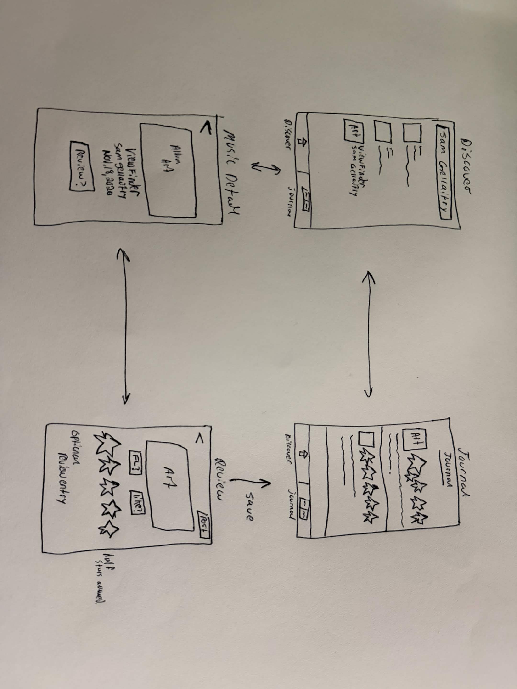

Bside Capstone README
===

# Bside

## Table of Contents

1. [Overview](#overview)
2. [Product Spec](#product-spec)
3. [Wireframes](#wireframes)
4. [Project Progress](#project-progress)
5. [Schema](#schema)

## Overview

### Description

Bside is a music journal where you can search for songs and albums, see their artwork, and record what you thought after listening. You can mark a first listen, give a rating, write a short review, and revisit your entries in your personal journal.

### App Evaluation

- **Category:** Music and personal journaling
- **Mobile:** Bside lets you search for music and record a reaction wherever you listen. Artwork and a quick rating flow make it easy to add an entry on your phone.
- **Story:** Music can become tied to a moment, but it is easy to forget what a first listen felt like. Bside gives those reactions a place to live so you can look back at how your taste grows, compare with others, or show off your music taste.
- **Market:** Bside is for music fans who enjoy discovering songs and albums and want a personal place to rate, review, and remember them.
- **Habit:** Users can return whenever they discover a song or album, then revisit their journal to see what they listened to and how they felt about it.
- **Scope:** The first version focuses on music search, artwork, and a saved journal for songs and albums with ratings, first listen status, and short reviews. This keeps the project focused enough to build and polish within the class timeline.

## Product Spec

### 1. User Stories (Required and Optional)

**Required Must-have Stories**

**Required Must-have Stories**

- [x] A user can search for music and see matching songs and albums with artwork.
- [x] A user can select a song or album to view its details.
- [ ] A user can mark whether an entry is a first listen.
- [ ] A user can give a song or album a rating and write a short review.
- [ ] A user can save an entry and find it in their personal journal.
- [ ] A user's journal entries remain available after closing and reopening the app.

**Optional Nice-to-have Stories**

* A user can play a short song preview when one is available.
* A user can filter their journal to view songs or albums separately.

### 2. Screen Archetypes

- [x] Discover Screen
  * Users can search for music and see matching songs and albums with artwork.
- [x] Music Detail Screen
  * Users can select a song or album and view its details.
- [ ] Review Screen
  * Users can mark a first listen, give a rating, write a short review, and save the entry.
- [ ] Journal Screen
  * Users can revisit saved entries, including their ratings and reviews, after reopening the app.

### 3. Navigation

**Tab Navigation** (Tab to Screen)

* Discover opens the Discover Screen.
* Journal opens the Journal Screen.

**Flow Navigation** (Screen to Screen)

- [x] Discover Screen
  * Selecting a search result opens the Music Detail Screen.
- [ ] Music Detail Screen
  * [x] Selecting a track from an album opens that song's Music Detail Screen.
  * Choosing to review the selected song or album opens the Review Screen.
- [ ] Review Screen
  * Saving the review opens the Journal Screen so the new entry is visible.
- [ ] Journal Screen
  * The Journal tab opens this screen to show saved entries.

## Wireframes

## Project Progress

### Unit 8 Submission Checkpoint

Bside ran in the simulator with Discover and Journal tabs. In Discover, a user could search the music catalog and see matching songs and albums in a scrolling list with their titles and artists. Searching again replaced the previous results.

At this checkpoint, Music Detail, Review, and saved Journal entries were still in development. Showing artwork beside each search result was the next design step.

[Watch the Unit 8 progress video](https://www.loom.com/share/835269e31e2246f4b1ce620f44674c5b)

### October 27 Checkpoint

Discover now shows artwork alongside matching songs and albums. Selecting a result opens Music Detail with its artwork, title, and artist. Opening an album loads its track list, and selecting a track opens that song's detail screen. I tested going back and opening a different album to confirm that its own tracks appear.

The next focus is opening Review from Music Detail, recording a rating and listening notes, and saving entries so they appear in Journal after the app is reopened.

## Schema 

[This section will be completed in Unit 9]

### Models

[Add table of models]

### Networking

- [Add list of network requests by screen ]
- [Create basic snippets for each Parse network request]
- [OPTIONAL: List endpoints if using existing API such as Yelp]
